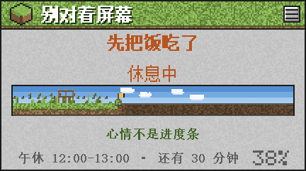
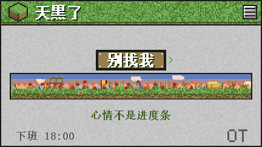
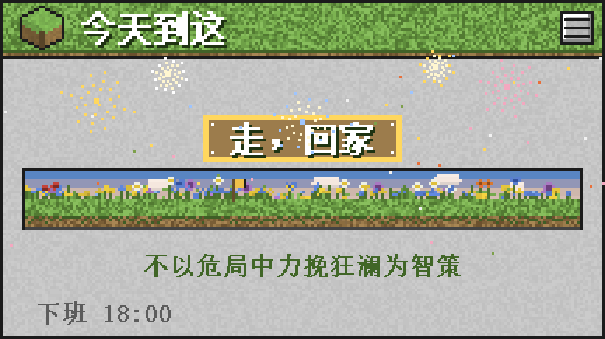

# MC 工时牌 · Minecraft 像素风置顶工时挂件

> **接手开发 / 智能体请先读 [`AGENTS.md`](AGENTS.md)** —— 环境、验收命令、五条铁律、已知坑都在那里。

一个贴着桌面右下角的 Minecraft 风格小木牌：无边框、置顶、可拖动，右键临时穿透，
每天登记上班时间，实时算「距离下班」和「今日已加班」。

  

## 它长什么样


 

```
┌──────────────────────────────────────┐
│ 🟩草方块 最后一段            ≡     │  ← 顶部草皮带：图标 + 时段问候 + 菜单
│                                      │
│               距离下班               │
│           02 小时 40 分钟            │  ← 5×7 点阵数字，整数倍放大
├──────────────────────────────────────┤
│ ░░░░░░░░░░░░░░░░░░░░░░░░░░░░░░░░░░░░ │  ← 天空 10 单位：云、烟花、星芒都在这
│ ░░░░░░░░░░░░░░░░░░░░░░░░░░░░░░░░░░░░ │
│ ▓▓▓▓▓▓▓▓▓(⚑)▓▓▓▓▓▓(●)▒▒▒▒▒▒▒▒▒▒▒▒▒ │  ← 花海（⚑ 午休旗）(●) 草皮卷 / 暗泥
│ ████████████████████████████████████ │  ← 草地 6 单位 + 泥土剖面 4 单位
├──────────────────────────────────────┤
│          沉住气，做完这一段          │  ← 每日一句：固定一行，跨天自动换
│ 上班 09:00 · 下班 18:00          67% │  ← 底栏
└──────────────────────────────────────┘
```

尺寸与画法的细节（花怎么分层、草皮卷怎么画）在 [docs/美术与实现细节.md](docs/美术与实现细节.md)。

## 到点之后（F1）

 

18:00 一到，进度条上方会立起一块木牌，牌上的话每天随机（「下班了」「今天到这」「收工」
「到点了」「该走了」「撤了」「够了」）。它不是装饰：

* 鼠标移上去，牌子的描边会亮起来、光标变成手型，右端还有一颗一闪一闪的小箭头——
  不用写"点击我"，看一眼就知道能点。
* **停 0.7 秒**（或直接点一下），牌子变成「还加班吗」，下面浮出两个按钮：**回家**（绿）
  和**再干会儿**（灰）。
* **25 秒没反应**会自动弹出这两个选项（`ui.fx.offer_idle_seconds` 可调），免得你走神错过。



选「回家」的那一刻，5 秒庆祝：白闪一帧、六簇像素烟花错峰炸开、44 片彩纸从顶上飘下来，
牌面换成「走，回家」并镶一圈金边。之后窗口变成"今天干了 08 小时 00 分钟 / 下班 18:00 ·
明天见"，而且**18:00 之后的分钟不再往累计加班里记**。

选「再干会儿」则进入加班模块：牌子收起，显示「加班中 / 已加班 N 分钟」，天色继续往夜里走。
误点了也不怕——右键菜单里有「今天就到这（收工）」。

两个选择都按天写进 `data.json`，重启、换档、切天后依然记得，不会再问第二遍。

## 操作方式

| 动作 | 结果 |
| --- | --- |
| 左键拖动 | 移动窗口，松手即记住坐标 |
| **右键单击** | 临时穿透：窗口半透明 + 鼠标可点穿到下层，默认 3 秒后自动恢复 |
| 左键双击 | 打开「设置上班时间」 |
| **点收工牌** | 下班后出现，点一下展开「回家 / 再干会儿」 |
| 点右上角 ≡ | 打开右键菜单 |
| 托盘左键 | 显示 / 隐藏窗口 |

右键菜单：修改今日上班时间 · 设置… · 重置当日计时 · 查看累计加班时长 · 窗口尺寸（小/标准/大）
· 每日一句开关 · 临时穿透 · 开机自启开关 · 最小化到托盘 · 退出。

## 计时规则

* 每天手动登记上班时间（跨天自动重置，启动时会提示登记）。
* **下班时间是直接选的**，不是"上班加八小时"算出来的——公司几点下班是定死的，
  今天十点才到，也就是少干一小时，不会因此把下班时间推到十九点。
* 第一次打开（还没选过）时，按**在岗 9 小时、扣 1 小时午休**先推一个默认值
  （9:00 上班 → 18:00 下班）垫在设置里；改一次，以后就一直用你选的那个。
* 有效工时 = 上班→下班 的跨度 − 落在午休里的那一段。所以午休改成 90 分钟，
  有效工时自动少半小时，进度条不会因为改设置就跳一下。
* 上班时间、下班时间、午休开始、午休时长，**四项都能在「设置…」里改**；改完立即生效
  并写回 `config.json`，重启依然记得。
* 周六周日直接休息，不做节假日识别。

累计加班 = 历史每日结算值之和 + 今日实时，零点结算当天、累计不清零，只有手动才能清空。
选了「回家」的那一天不会把 18:00 之后的分钟记进加班。

## 设置


右键菜单 →「设置…」，四项：

| 项 | 说明 |
| --- | --- |
| 上班时间 | 今天几点到（等价于「修改今日上班时间」） |
| 下班时间 | 几点走。第一次打开时按 9 小时在岗推一个默认值（9:00 → 18:00），改过就记住 |
| 午休开始 | 默认 12:00。里程碑、午休旗、"还剩多久"都依赖它 |
| 午休多长 | 0~240 分钟，按 15 分钟加减，默认 60 |

对话框底部实时算一句"有效工时 8 小时"，改之前就知道这一天要干多久。
下班时间填得比上班时间还早时，会直接提示"下班时间早于上班时间，请检查"。

## 快速开始

```bat
:: 双击 启动.bat 就行（会自动装依赖、无黑框启动）
:: 或者手动：
python -m pip install -r requirements.txt
pythonw main.py
```

详细环境、参数、数据格式见 [环境配置说明.md](docs/环境配置说明.md)。
打包单文件 exe 见同级 `打包工程` 文件夹。

> `启动.bat`（走 Python）和 `MCWorkTimer_v1.0.exe`（免安装）的 `data.json` 不在同一个目录，
> 挑一个长期用，不要混着开，否则加班台账会分成两份。

## 还想看细节

- 花海怎么分层铺、草皮卷的螺旋怎么描、
  513 句文案怎么分、代码结构与技术要点
  → [docs/美术与实现细节.md](docs/美术与实现细节.md)


