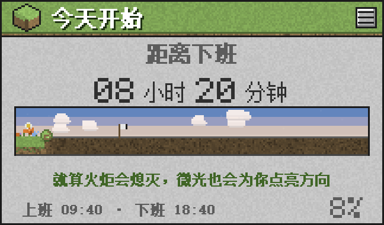
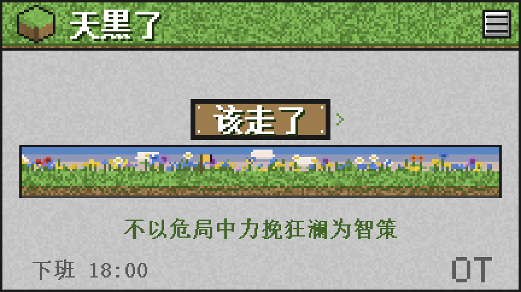
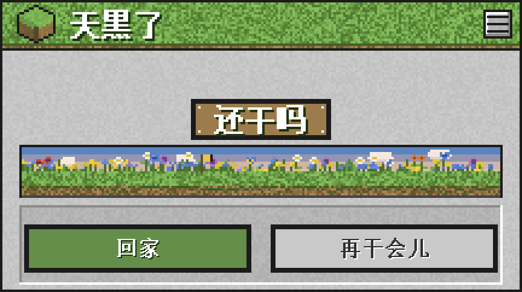
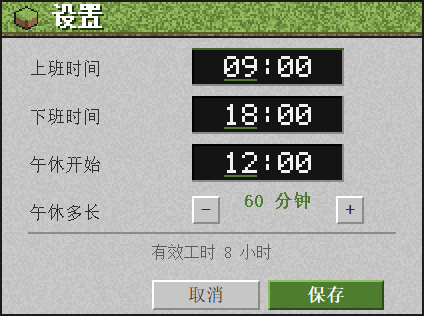

# MC 工时牌 · Minecraft 像素风置顶工时挂件

> **接手开发 / 智能体请先读 [`AGENTS.md`](AGENTS.md)** —— 环境、验收命令、五条铁律、已知坑都在那里。

一个贴着桌面右下角的 Minecraft 风格小木牌：无边框、置顶、可拖动，右键临时穿透，
每天登记上班时间，实时算「距离下班」和「今日已加班」。

  

## 下载

| 渠道 | 地址 | 说明 |
| --- | --- | --- |
| **蓝奏云**（国内推荐） | https://wwbpm.lanzoue.com/iyhrj4gu68ch | 提取码 `cvre`，国内直连、速度快 |
| GitHub Releases | [Releases](../../releases) | 官方版本，国内可能需要网络加速 |

下载后双击 `MCWorkTimer_v1.0.exe` 就能用，不需要装 Python。
首次运行如果提示「已保护你的电脑」，点「更多信息」→「仍要运行」。

## 它长什么样



 

```
┌──────────────────────────────────────┐
│ 🟩草方块 最后一段            ≡     │  ← 顶部草皮带：图标 + 时段问候 + 菜单
│                                      │
│               距离下班               │
│           02 小时 40 分钟            │  ← 5×7 点阵数字，整数倍放大
├──────────────────────────────────────┤
│ ░░░░░░░░░░░░░░░░░░░░░░░░░░░░░░░░░░░░ │  ← 天空 10 单位：云、烟花、星芒都在这
│ ░░░░░░░░░░░░░░░░░░░░░░░░░░░░░░░░░░░░ │
│ ▓▓▓▓▓▓▓▓▓(⚑)▓▓▓▓▓▓(●)▒▒▒▒▒▒▒▒▒▒▒▒▒ │  ← 花海（⚑ 午休旗）(●) 草皮卷 / 暗泥
│ ████████████████████████████████████ │  ← 草地 6 单位 + 泥土剖面 4 单位
├──────────────────────────────────────┤
│          沉住气，做完这一段          │  ← 每日一句：固定一行，跨天自动换
│ 上班 09:00 · 下班 18:00          67% │  ← 底栏
└──────────────────────────────────────┘
```

标准档 432×242（216×121 单位 × 2px）。进度条从最早的 18 单位加到 22 单位
（**天空 12、草皮 4、泥土 4**）：草皮原来有 6 格，一整条纯绿压得花只剩一排小点，
压到 4 格、把高度让给天空之后，花能长高、颜色也成了片，才像"花海"而不是"草坪"。
腾出来的高度从"两排字"里挤，每日一句和底栏都从 22px 降到 18px。

进度条不是纯色块，是一整条**从左往右开垦的花海剖面**：上层是蓝天白云，下层是泥土与
草皮，左边已经开垦成草地、开满花，右边还是压实的暗色泥地。花有 7 种（罂粟、蒲公英、
雏菊、矢车菊、大花葱、郁金香、蓝亚麻），每天挑三种当主花，所以花色成片、换天有变化。
所有花都长在框内。

**花是按高度分成四条带铺的，不是一层铺满**（`_draw_flower_field`）。铺满时糊掉，是两件事
叠在一起：花茎是 1 单位宽的深色竖线，一根看不出来、两百根就是"竖线森林"；花冠又都落在
同一高度，连起来成了"一条彩色边"。所以：

| 花带 | 花冠落在 | 画法 | 作用 |
|---|---|---|---|
| 高枝 | 8~11 单位 | 带茎（真茎，只此一层） | 把上沿打散，不贴顶 |
| 次高 | 5~9 | **不带茎** | 和主层错开，出高低 |
| 主层 | 3~7 | **不带茎**，最密 | 花海的主体 |
| 贴地 | 0~4 | **不带茎**，小碎花 | 地面颗粒感 |

"不带茎"是这套画法的关键：只落一个花冠，靠底下那层草叶接着，读起来是**花自己开在花海里**；
一旦给它补一根托线，不管换成什么颜色，都变成"插在签子上"。同层内下一朵至少让出
"花冠宽 + 1 格"，两朵花冠永远不并成一坨，所以铺满了也是一朵是一朵。
蓝亚麻只有 2×2 像素，只留在贴地花毯里——它做花冠太碎，密了就是噪点。

草地不只有花：按进度条的 19% / 53% / 84% 三个位置埋了**道具**（木栅栏 / 干草堆 / 石堆，
按日期轮换），铺到那儿才会长出来。它们不是生物，不用"像"什么具体东西——轮廓不糊、
颜色不撞，就够了。

**推进前沿是一卷草皮**（植物大战僵尸加载界面那种演法）：不是一道竖线，是草地尽头躺着的
**一卷草皮**，端面朝我们。

端面为什么不像球：草皮是一层压一层卷起来的，切开的断面必然是**"草 + 一条土"交替的螺旋**。
所以端面只做两件事——平涂绿身（柱面光，上亮下暗，**不要**球面那种中心高光），再沿参数
曲线逐格描一条土色螺旋，从外缘一路卷到卷芯。线条是**走出来的**（240 步采样后取整到格），
保证连成一条；用"每格算深度再分区上色"的做法会在像素尺度上碎成断点。卷芯特意偏在右下
（`corex, corey = 0.90, 0.62`）——真实的卷，芯绝不可能端端正正落在几何中心，这一条比任何
打光都更能把"球"排除掉。卷底沾一层土、压进草皮两格，就落在地上了。

进度往前走时它整体滚过去而不是跳一格：卷子颠两下、底部扬一阵土，大约 0.8 秒。转过的角度
和走过的距离挂钩（`_SOD_ROLL_TURN_PER_UNIT`），不是原地打转；平时不推进时只以极慢的转速
待机，所以能看见螺旋在慢慢绕。

**大小从大变小**（`_roll_radius`）：起手是完整的一卷 7×7，铺开一段（三成左右）就瘦成
5×5 的薄卷——一卷草皮摊开多少就少多少，这是现实里最直观的规律。尺寸上限从原来的 9×9
收到 7×7：再大一档就成了"草地上一颗绿球"，反而看不出是卷。小档草皮带只有 2 单位高，
卷固定 5×5。

天空不是死蓝：颜色连续插值——黎明粉紫、上午通透、正午最亮、黄昏橙红、夜里深蓝带星，
云朵会横着慢慢飘（约 7 分钟飘完一整条），花色也跟着一起变暗，夜里不会发光。

而且这一整套天色是**按你的上班时段铺开的**，不是按真实 24 小时：默认从「上班时间」起
13 小时走完「日出 → 正午 → 日落 → 入夜」。所以 8:00 上班的人，8 点看到的是刚亮的天、
下午转暖、18 点前后日落、21 点收工时天已经黑透、开始有星星——不会出现「动画最漂亮
的几段全在凌晨四点和深夜，你根本看不见」的情况。上班时间改早/改晚，整套天色跟着平移。
（想严格按真实钟点走，把 `ui.sky_mode` 改成 `clock`；想让天色走得快点慢点，调
`ui.sky_span_hours`，默认 13。）

三档尺寸（右键 ▸ 窗口尺寸，切换后自动记住）：

| 档位 | 尺寸 | 内容 |
| --- | --- | --- |
| 小 | 336×112 | 迷你窄条：草皮带里显示状态文案 + 大数字 + 草地条，不带底栏和每日一句 |
| 标准 | 432×242 | 完整信息（默认） |
| 大 | 648×363 | 同一布局放大 1.5 倍，适合远看 |

小档的草皮带加高到 17 单位、状态文案用 22px 点阵字（跟标准档标签同一档粗细），
并且是**按字形墨迹垂直居中**的——上下留白各 5px，跟左边草方块、右边三横线按钮
严格同一条中线，不会像早期版本那样顶到上边框。

切档是**按整数倍重新绘制**，不是把画面拉伸，所以像素永远是硬边。

五种状态自动切换：

| 状态 | 主面板显示 | 说明 |
| --- | --- | --- |
| 上班前 | 距离上班 XX 小时 XX 分钟 | 还没到登记时间，进度条 0% |
| 计时中 | 距离下班 XX 小时 XX 分钟 | 常规状态 |
| 午休中 | **休息中** | 12:00–13:00，计时暂停，草地压暗、花收成花苞 |
| 下班后 | **当日已加班 XX 分钟** | 主面板只显示加班，累计值在菜单里 |
| 周末 | **休息日** | 周六周日不计时；未登记时显示「未设置」 |

## 操作方式

| 动作 | 结果 |
| --- | --- |
| 左键拖动 | 移动窗口，松手即记住坐标 |
| **右键单击** | 临时穿透：窗口半透明 + 鼠标可点穿到下层，默认 3 秒后自动恢复 |
| 左键双击 | 打开「设置上班时间」 |
| **点收工牌** | 下班后出现，点一下展开「回家 / 再干会儿」 |
| 点右上角 ≡ | 打开右键菜单 |
| 托盘左键 | 显示 / 隐藏窗口 |

右键菜单：修改今日上班时间 · 设置… · 重置当日计时 · 查看累计加班时长 · 窗口尺寸（小/标准/大）
· 每日一句开关 · 临时穿透 · 开机自启开关 · 最小化到托盘 · 退出。

## 到点之后（F1）

 

18:00 一到，进度条上方会立起一块木牌，牌上的话每天随机（「下班了」「今天到这」「收工」
「到点了」「该走了」「撤了」「够了」）。它不是装饰：

* 鼠标移上去，牌子的描边会亮起来、光标变成手型，右端还有一颗一闪一闪的小箭头——
  不用写"点击我"，看一眼就知道能点。
* **停 0.7 秒**（或直接点一下），牌子变成「还加班吗」，下面浮出两个按钮：**回家**（绿）
  和**再干会儿**（灰）。
* **25 秒没反应**会自动弹出这两个选项（`ui.fx.offer_idle_seconds` 可调），免得你走神错过。


选「回家」的那一刻，5 秒庆祝：白闪一帧、六簇像素烟花错峰炸开、44 片彩纸从顶上飘下来，
牌面换成「走，回家」并镶一圈金边。之后窗口变成"今天干了 08 小时 00 分钟 / 下班 18:00 ·
明天见"，而且**18:00 之后的分钟不再往累计加班里记**。

选「再干会儿」则进入加班模块：牌子收起，显示「加班中 / 已加班 N 分钟」，天色继续往夜里走。
误点了也不怕——右键菜单里有「今天就到这（收工）」。

两个选择都按天写进 `data.json`，重启、换档、切天后依然记得，不会再问第二遍。

## 情绪化的五个小机关

| 编号 | 名字 | 出现时机 | 做什么 |
| --- | --- | --- | --- |
| F3 | 时段问候 | 全天 | 顶部「工作计时」换成一句话：正经的（开工了 / 最难的一段）和自嘲的（假装很忙 / 靠意志力撑着 / 天黑了，人还在）混着放，每天按日期取模 |
| F2 | 里程碑 | 跨过 25%、75%、90% | 草皮卷离地跳一下、底部扬土、右下百分比变金色并描一层深金影，顶部短语顶 8 秒 |
| F1 | 收工 | 到点之后 | 见上一节 |
| F6 | 鸟群路过 | 一天 2~3 次 | 一小群鸟排成 V 字从天上斜着飞过，21 秒走完；时刻按日期算出，今天几点来固定 |
| F4 | 月亮 | 日落后 | 天空挂一轮带光晕的月，云从它前面飘过去 |
| F7 | 天气 | 全天 | 按日期定晴（62%）/ 阴（24%）/ 雨（14%）：阴天压暗一档、云发灰；雨天天空压成灰蓝、云变脏、雨丝成片往下落。右键菜单只有一条「天气：晴」——字报今天什么天，勾是开关；勾掉时光云一起收走，所以晴天勾也有变化 |

50% 那个点**特意不设**里程碑：默认 9 点上班时它正好落进午休（13:00），没人看屏幕。
午休开始（12:00）改成进度条上的一面小旗子——常驻地标，过了就点亮成金色，一眼知道
"今天几点开始午休、自己铺到旗子哪一边了"。

**为什么是"一群鸟"**：这条带子只有 100 单位宽、12 单位高的天空。在这上面画过蝴蝶、
蜜蜂、单只小鸟，也按原版比例画过猪、牛、羊、鸡——结论是**小到看不见，大到不成比例**：
猪牛按原版像素密度摊开是 48×32px 起，塞进这条带子里又大又突兀，缩小到不突兀时
又只剩一团色块。最后成立的只有鸟群：单只认不出（10px 的鸟就是个污点），但六只排成
V 字一起移动，队形本身就成了信号——跟花海靠"重复"成片是同一个道理。

萤火虫同理（夜里黄花铺满草带，2px 光点混进花瓣就没了），最后换成了月亮：大形状、
干净背景，反而最稳。

**雨天为什么能成立，而萤火虫不行**：雨是**成片的竖线**，属于"重复成片"那一类，跟花海、
鸟群队形同一原理；萤火虫是孤立的单点，孤点在这个尺寸上就是噪点。另外两条后加的约束：

* **雨只落在天空那一段。** 落到花海上会变成一片白噪点，把主角盖掉——草地带只保留
  "压暗、湿了"的感觉（一层低透明度冷色）。
* **压暗用天色系数，不靠盖灰。** 雨天把天空亮度乘 0.70、饱和度一起降，云跟着变脏；
  再叠一层很淡的冷色收尾。整窗提亮/闪光早被否过（像闪屏），这里同理只做"变暗"不做"跳亮"。

雨丝要动，但主计时器 1 秒才醒一次，所以下雨天额外开一条 **8fps** 的小定时器
（`_rain_timer`）——只在「真的下雨 + 窗口可见 + 开关打开」时跑，其余时候停着。
实测满花海的雨天单帧绘制约 6ms，8fps 约 5% 单核。

这几件事全部可关：`ui.fx.greeting` / `milestone` / `celebrate` / `offer` / `life` / `moon` / `weather`，
全关掉以后界面与上一版逐像素一致（新东西都叠在绘制末尾，不参与主布局计算）。

## 每日一句

进度条和底栏之间留了一行固定位置放一句话（标准 / 大档；小档没有这一行）—— 有劝你干活的，
也有替你把心里话说出来的。句子按**日期**
取：同一天里始终是同一句（重启、切档都不变），过了零点自动换下一句，不用接口、不联网。

内置 **513 句**，分三段：333 句通用（开工、专注、节奏、疲惫、收尾、情绪、生活边界…）、
32 句打工人自嘲、148 句米哈游台词（占 **28.9%**）：

| 作品 | 句数 | 主要角色 |
| --- | --- | --- |
| 原神 | 45 | 钟离、甘雨、刻晴、温迪、迪卢克、凝光、纳西妲、提纳里、胡桃、莫娜、雷电将军… |
| 崩坏：星穹铁道 | 54 | 姬子、卡芙卡、砂金、流萤、刃、托帕、翡翠、黑塔、景元、白露、真理医生… |
| 崩坏3 | 32 | 姬子、琪亚娜、爱莉希雅、凯文、奥托、丽塔、卡莲、芽衣、梅比乌斯… |
| 绝区零 | 17 | 月城柳、哲／铃、安东、伊芙琳、普罗米娅、波可娜、猫宫又奈… |

"打工人自嘲"那 32 句是另一种调子：正经话是劝你干活，这组是替你把心里话说出来——
「看起来忙，比忙更重要」「工位是第二个家，可惜不供暖」「今天也要好好活着」。分寸只有一条：
**自嘲处境，不贬低人**，所以池子里不会出现"我不行""没意义"这种往人身上踩的句子。
它占 6.2%，约十六天轮到一次，不至于天天阴阳怪气。

原文优先，只有一行放不下的才删虚词；原文写在每条的 `#` 注释里。个别按角色语气补写的
标了「拟」，来源写在注释中，不与原作台词混淆。宿命向的名句（砂金「遍历死地而后生」、
凯文「鸟，为什么会飞」、流萤「我将，点燃大海」、雷电将军「人之在世如白露泡影」等）也
收进来了——它们是这些作品最有分量的那几句。

- **周期 = 池子长度**：513 句 → 513 天一轮，一轮内绝不重复（连续 513 天对 513 取模，
  余数 0..512 各走一遍）。第 514 天回到第一天。
- 顺序看不出规律：取之前先按**固定种子**做一次确定性洗牌（自实现 Fisher-Yates +
  xorshift32，跨 Python 版本结果一致），所以不是"顺着列表走"。
- 字号跟着长度走：一行 18px 为基准（`quote_size`），更长的句子再自动降一档到 17px——
  宁可字小一点，也不删原文。上一版用的是 22px，字太大把窗口压得很挤，这一版统一收了。
- **句末不带句号**：513 句都按一行短句处理，句中逗号保留、问号感叹号保留，只去掉结尾的
  「。」；你自己加的句子（`ui.quotes`）带了也会自动去掉。

想换成自己的话，改 `config.json` 的 `ui.quotes` 列表即可（留空 `[]` 就用内置的）：

```json
"ui": {
  "quote": true,
  "quote_shuffle": true,
  "quotes": ["先完成，再完美", "打完这排砖，就下班"]
}
```

`ui.quote` 设为 `false`（或右键菜单里取消「每日一句」）就整行不画，窗口高度不会变；
`ui.quote_shuffle` 设为 `false` 就按列表原顺序一天一句地轮。

> 穿透期间窗口保持置顶、但禁止拖动，只改透明度和鼠标穿透属性，不会丢置顶。

## 计时规则

* 每天手动登记上班时间（跨天自动重置，启动时会提示登记）。
* **下班时间是直接选的**，不是"上班加八小时"算出来的——公司几点下班是定死的，
  今天十点才到，也就是少干一小时，不会因此把下班时间推到十九点。
* 第一次打开（还没选过）时，按**在岗 9 小时、扣 1 小时午休**先推一个默认值
  （9:00 上班 → 18:00 下班）垫在设置里；改一次，以后就一直用你选的那个。
* 有效工时 = 上班→下班 的跨度 − 落在午休里的那一段。所以午休改成 90 分钟，
  有效工时自动少半小时，进度条不会因为改设置就跳一下。
* 上班时间、下班时间、午休开始、午休时长，**四项都能在「设置…」里改**；改完立即生效
  并写回 `config.json`，重启依然记得。
* 周六周日直接休息，不做节假日识别。

累计加班 = 历史每日结算值之和 + 今日实时，零点结算当天、累计不清零，只有手动才能清空。
选了「回家」的那一天不会把 18:00 之后的分钟记进加班。

## 设置



右键菜单 →「设置…」，四项：

| 项 | 说明 |
| --- | --- |
| 上班时间 | 今天几点到（等价于「修改今日上班时间」） |
| 下班时间 | 几点走。第一次打开时按 9 小时在岗推一个默认值（9:00 → 18:00），改过就记住 |
| 午休开始 | 默认 12:00。里程碑、午休旗、"还剩多久"都依赖它 |
| 午休多长 | 0~240 分钟，按 15 分钟加减，默认 60 |

对话框底部实时算一句"有效工时 8 小时"，改之前就知道这一天要干多久。
下班时间填得比上班时间还早时，会直接提示"下班时间早于上班时间，请检查"。

## 快速开始

```bat
:: 双击 启动.bat 就行（会自动装依赖、无黑框启动）
:: 或者手动：
python -m pip install -r requirements.txt
pythonw main.py
```

详细环境、参数、数据格式见 [环境配置说明.md](docs/环境配置说明.md)。
打包单文件 exe 见同级 `打包工程` 文件夹。

> `启动.bat`（走 Python）和 `MCWorkTimer_v1.0.exe`（免安装）的 `data.json` 不在同一个目录，
> 挑一个长期用，不要混着开，否则加班台账会分成两份。

## 代码结构

2026-11-20 做过一次"只搬家、不改功能"的整理：原来 `theme.py`（1333 行）和 `widget.py`
（1227 行）两座大山，按"画什么 / 干什么"分成了几个抽屉。加新东西时，先找对应抽屉，
不用再通读一千多行。

```
app/
├─ widget.py        窗口本体（232 行）：构造、尺寸档、位置记忆、显示隐藏
├─ ui/              窗口的四个职责，各自一个文件
│   ├─ consts.py        三档尺寸、星期名
│   ├─ clock.py         计时与状态推进（走时、草皮卷、里程碑、鸟群、到点询问）
│   ├─ content.py       文字内容（标题、大数字、两排小字、每日一句、问候语）
│   ├─ paint.py         画面绘制（整窗画面、木牌、两个选项、庆祝动画）
│   └─ interact.py      鼠标与菜单（拖动、点击命中、右键菜单、弹窗、托盘、穿透）
├─ render/          画面零件，各自一个文件
│   ├─ palette.py       配色与一天的光线（色温、天空色）
│   ├─ common.py        基础画笔（方块填充、斜面、程序化材质、面板、按钮）
│   ├─ chrome.py        边框装饰件（图标、菜单按钮、草皮条）
│   ├─ sky.py           天空（云、月亮、鸟群）
│   ├─ meadow.py        草地（花海、草皮卷、道具、整条天空进度条）
│   ├─ weather.py       天气（阴天压色、雨丝）
│   └─ overlay.py       覆盖层（木牌、两个选项、烟花、彩纸）
├─ theme.py         转发出口：老的 `theme.xxx` 写法照旧有效
├─ engine.py        工时规则与状态（纯逻辑，不依赖 Qt）
├─ quotes.py        所有文案
├─ weather.py       今天什么天（纯逻辑，按日期播种）
├─ life.py          今天鸟群几时飞过
└─ pixel_font.py    点阵数字 + 像素中文字
```

**想加东西时的去处**：新道具 → `render/meadow.py`；新天气 → `weather.py` + `render/weather.py`；新鸟群队形 → `render/sky.py`；
新文案 → `quotes.py`；新菜单项 → `ui/interact.py`；新计时规则 → `engine.py`。

**检查工具**（`tools/`，不参与打包）：

* `baseline_shots.py <目录>` —— 把 31 个画面状态各拍一张图
* `compare_shots.py <前> <后> [差异图目录]` —— 逐像素比对，不一样的标红
* 以后改完画面，先拍一遍再比对，能立刻发现"哪儿偷偷变了"

## 技术要点

* **PySide6** 全自绘，无 QML；没用 tkinter。
* 所有绘制先进一张 **1:1 物理像素缓冲区**，再整体贴回窗口：任何 DPI 缩放都不会糊。
* 草方块 / 泥土 / 石头材质在「1 单位 = 1 像素」画布上用确定性噪声生成，整数倍放大 =
  真方块质感，不依赖任何图片资源。
* 数字用内置 5×7 点阵（与 MC `ascii.png` 同一网格）；中文按 12px 无抗锯齿渲染后整数倍
  最近邻放大，得到 MC 中文那种点阵感。
* 穿透用 Win32 `WS_EX_TRANSPARENT | WS_EX_LAYERED` 改扩展样式，**不重建窗口**，所以置顶
  不失效、无闪烁；比 `setWindowFlag` 稳。
* 草地进度条按"已开垦宽度"逐列生成：天空 → 锯齿地平线 → 泥土 → 草皮 → 花；所有随机
  都取自 `日期` 播种的 rng，同一天画面完全固定（每秒重绘不闪），换天自然换一片花。
* 草皮卷按**断面**画：`_roll_cells(r)` 给轮廓（`ux² + uy² ≤ (r+0.5)²` 的整圆），端面平涂
  绿身，亮度 `1.20 - 0.15·h - 0.05·d`（h 是上下位置）——柱面光，不是球面那种中心高光。
* 断面上那道**土色螺旋**是走出来的：沿参数曲线采样 240 步取整到格，逐格描土色，保证连成
  一条。螺距 `t^1.1` 收窄、卷芯偏在 (0.90, 0.62)，所以是"由大向小"地卷进去，且芯不在
  正中间。中途试过"每格算深度再分区上色"，像素尺度上会碎成断点，弃用。
* 卷底沾土压进草皮 2 格；没有额外拖尾——左边已经铺满草，右边是还没铺的暗泥，中间这卷
  自己就是分界。
* 尺寸从大变小：`_roll_radius()` 起手 7×7（整卷）→ 铺过三成瘦成 5×5；上限压到 3
  （原来 4，9×9 那档看起来就是"草地上一颗绿球"）。小档草皮带只有 3 单位高，卷固定 5×5。
* 天空、花海、草皮卷一律裁在内框里（`setClipRect`），所以云飘到边上、卷走到两头都不会
  溢出边框。
* 卷转多快是**算出来的**：`_roll_turns()` 用走过的比例 × 进度条单位数 ×
  `_SOD_ROLL_TURN_PER_UNIT`，滚多远转多少，不会出现"原地疯转"。
* 推进动画：`_tick` 发现 progress 涨了（且涨幅 ≤ 4%），就把前沿从旧位置缓动到新位置，
  跑 0.8 秒后自动停。动效定时器统一 **60fps（16ms）**——卷的滚动、里程碑的跳动、收工的
  烟花和彩纸都走这一条线，`ui.fx.fps` 可调低省电；平时仍是 1 秒 1 帧，不空转。
* 情绪化的三个机关都是**叠加绘制**，不参与主布局计算：`theme.draw_plank`（木牌）、
  `draw_sparkle`（十字星芒）、`draw_firework`（烟花）、`draw_confetti`（彩纸）、
  `draw_choice`（按钮）、`draw_lunch_marker`（午休旗）。全关掉时界面逐像素等于上一版。
* 里程碑的触发点只看 `snap.progress` 跨过 0.25/0.75/0.90 且状态必须是 WORKING——午休期间
  进度冻结，不会误触。同一天每个点只触发一次（`_ms_hit`），跨天清零。
* 天空用一天 10 个锚点（含星空浓度）做 RGB 插值，逐帧取真实时钟；云的横移量 = 秒数 ×
  0.45 单位，落点吸到单位网格上，所以是"一跳一格"的像素动画而不是平滑滑动。
* 花的高度按"框内可用高度 − 花冠高度"反推，头顶永远留 1 单位空隙。
* 色温用一天 10 个锚点做色相/饱和/明度插值，每小时只算一次并写进调色板；材质缓存的
  key 里带了草色，所以换色会自动失效重画，不用手动清缓存。
* `QTimer` 每秒重算快照，跨零点自动结算；数据 30 秒 + 退出时落盘。
* 单实例锁（QLockFile），重复启动只提示不会开两个。

## 许可

自用随意改。Minecraft 相关美术风格归 Mojang，本项目不复用任何官方素材，材质全部程序化生成。
